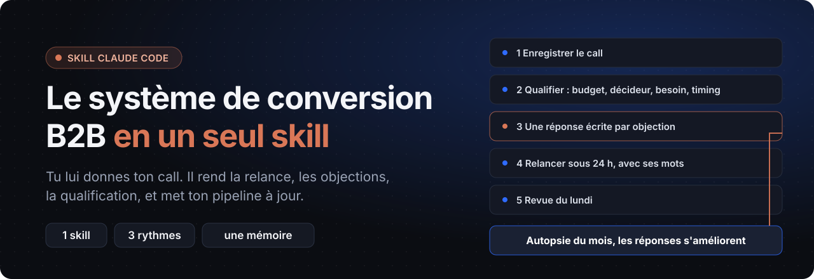
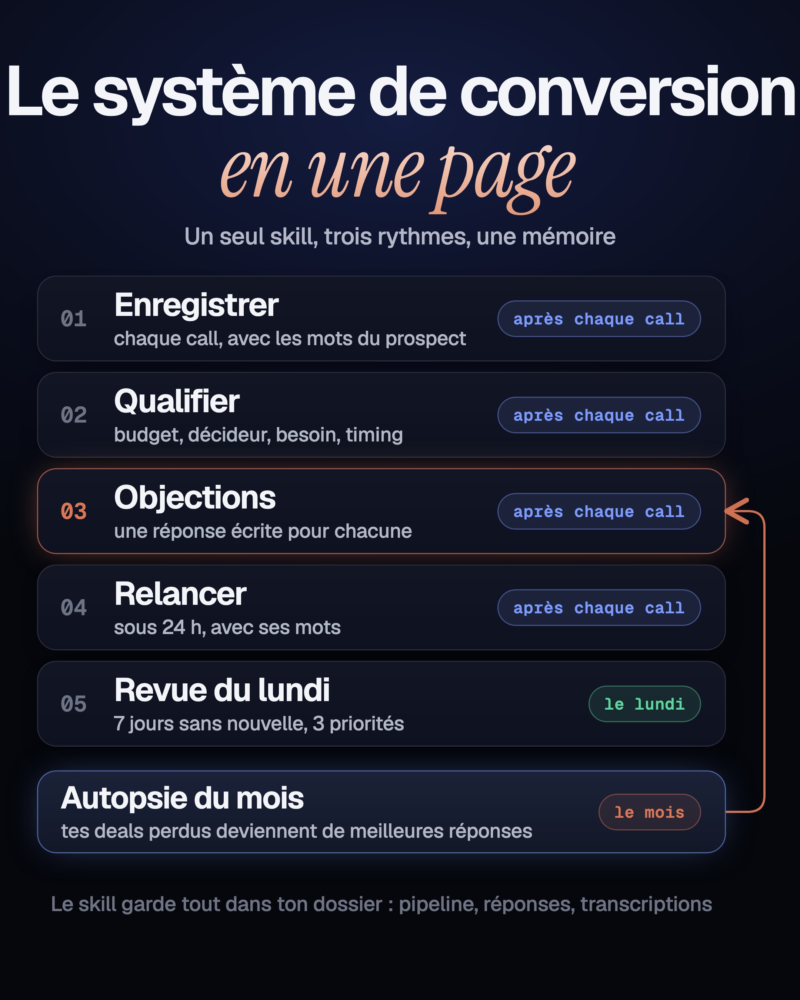
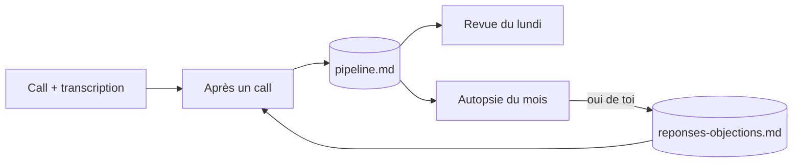

<p align="center">
  
</p>

<p align="center">
  <a href="LICENSE"></a>
  
  
  
</p>

<p align="center">
  <b>Tout le monde a un système pour générer des leads. Presque personne n'en a un pour les convertir.</b><br>
  Un seul skill qui traite chaque call, tient ton pipeline à jour et améliore tes réponses aux objections.
</p>

<p align="center">
  <a href="#avant-tout--tes-calls">Tes calls</a> ·
  <a href="#installation">Installation</a> ·
  <a href="#les-3-rythmes">Les 3 rythmes</a> ·
  <a href="#la-mémoire">La mémoire</a> ·
  <a href="#les-règles">Les règles</a> ·
  <a href="exemples/">Exemples</a>
</p>

---

## Avant tout : tes calls

Le skill travaille sur **ce que tes prospects disent vraiment pendant tes appels** : leurs objections, leurs mots, leurs chiffres. Sans transcription, il ne peut que deviner. Avec, chaque réponse s'appuie sur une citation.

Le plus simple : l'extension Chrome **[Weecloz](https://www.weecloz.io/)**. Elle enregistre tes calls sur Google Meet, Zoom et Teams, sans bot dans ta réunion. Après le call : onglet Transcript → Copier le transcript, et tu le colles dans la conversation.

> N'importe quelle transcription marche aussi, du moment qu'elle contient les noms des interlocuteurs (« [mm:ss] Nom : texte » ou « Nom : texte »). Si le format est inhabituel, le skill travaille dessus, mais sans la vérification par script. Pense à prévenir ton prospect que tu enregistres.

## Installation

Il te faut l'application Claude pour ordinateur, un abonnement Claude payant, et un **dossier de travail** (l'espace « Code » de l'application, avec un dossier que tu choisis).

**Le plus simple : demande à Claude de l'installer.** Colle ce message dans une conversation de l'onglet Code :

```text
Installe pour moi le plugin Claude Code « conversion », depuis la marketplace GitHub weecloz/conversion, pour mon compte (scope user) : ajoute la marketplace avec « claude plugin marketplace add weecloz/conversion », puis installe-le avec « claude plugin install conversion@weecloz-conversion ». Si la commande claude n'est pas trouvée, utilise l'exécutable Claude Code de cette session. Dis-moi quand c'est fait.
```

**Dans un terminal :**

```bash
claude plugin marketplace add weecloz/conversion
claude plugin install conversion@weecloz-conversion
```

**À la main :** copie le dossier [`conversion/`](conversion/) dans `~/.claude/skills/`.

Ensuite, dans une conversation de ton dossier de travail, parle normalement : « traite mon call avec Sarah ». Le skill démarre, te pose 3 questions la première fois, et crée ses fichiers.

## Les 3 rythmes

<p align="center"></p>

| Quand | Tu dis | Il fait |
|---|---|---|
| **Après chaque call** | « traite mon call avec Sarah » | résumé, qualification (BANT par défaut), objections comparées à ta bibliothèque, temps de parole, signaux d'achat, relance sous 24 h, notes CRM, et la mise à jour de ton pipeline |
| **Le lundi** | « fais ma revue du lundi » | ce qui a bougé, les deals qui dorment depuis 7 jours ou plus, ceux sans prochaine étape datée, tes 3 priorités, une relance par deal qui dort |
| **Une fois par mois** | « fais l'autopsie du mois » | les 3 raisons qui reviennent dans tes deals perdus, et de meilleures réponses à proposer pour ta bibliothèque d'objections |

La boucle se ferme au troisième rythme : une objection qui revient dans tes deals perdus devient une meilleure réponse écrite, que le skill reprend au call suivant.



## La mémoire

Le skill garde trois choses dans ton dossier de travail. Tu peux les ouvrir et les corriger à la main.

| Fichier | Contenu |
|---|---|
| `pipeline.md` | une ligne par deal : étape, montant, prochaine action datée, dernier contact, risque, statut |
| `reponses-objections.md` | ta bibliothèque : une réponse écrite par objection, avec la phrase à dire |
| `calls/` | tes transcriptions, une par call |

Avec `ma-vente.md` (ton offre, tes preuves, ton style), et un dossier `traitements/` qui range les sorties de chaque call. Les modèles vides sont dans [`modeles/`](modeles/).

## Les règles

- **Rien n'est inventé.** Chaque citation est vérifiée contre ta transcription par un script (quand Python est installé, ce qui est le cas sur un Mac) avant que tu la voies ; sinon, le skill écrit « non vérifié par script ». Une info incertaine est marquée « à vérifier ».
- **Rien n'est envoyé à ta place.** Le skill rédige, tu envoies.
- **Rien n'est écrit dans un CRM sans ton « oui ».**
- **Ta bibliothèque ne change qu'avec ton accord.** Un « non » la laisse identique.
- **Aucun chiffre promis.** Les seuils (relance sous 24 h, une objection qui revient 3 fois, 7 jours sans nouvelle) sont des règles du système, pas des résultats.

## Comment ça marche

Un dossier de skill classique : [`conversion/SKILL.md`](conversion/SKILL.md) choisit le rythme d'après ta demande, et lit le fichier du rythme (`apres-un-call.md`, `revue-du-lundi.md`, `autopsie-du-mois.md`). Quatre petits scripts Python, sans dépendance, font ce qu'un modèle ne doit pas deviner : le temps de parole, la vérification des citations, la lecture de ton pipeline, la lecture des transcriptions.

```text
conversion/
  SKILL.md   apres-un-call.md   revue-du-lundi.md   autopsie-du-mois.md
  formats.md   grille-qualification.md   objections-classiques.md
  scripts/   temps_de_parole.py   verifier_citations.py   pipeline.py   transcript.py
```

Si Python n'est pas installé sur ton ordinateur, le skill le dit une fois et fait les calculs sans script, en l'indiquant.

## Les tests

```bash
pip install pytest pyyaml
cd outils && python3 -m pytest -q
```

(Les scripts du skill n'ont besoin d'aucune installation ; `pytest` et `pyyaml` ne servent qu'aux tests.)

Les tests couvrent les scripts, la structure du skill et les exemples : [`exemples/`](exemples/) contient un call fictif, ses sept sorties et un pipeline d'exemple. Les citations de ces exemples sont vérifiées à chaque lancement.

## Licence

MIT, voir [LICENSE](LICENSE). Fait par [Weecloz](https://www.weecloz.io/).
